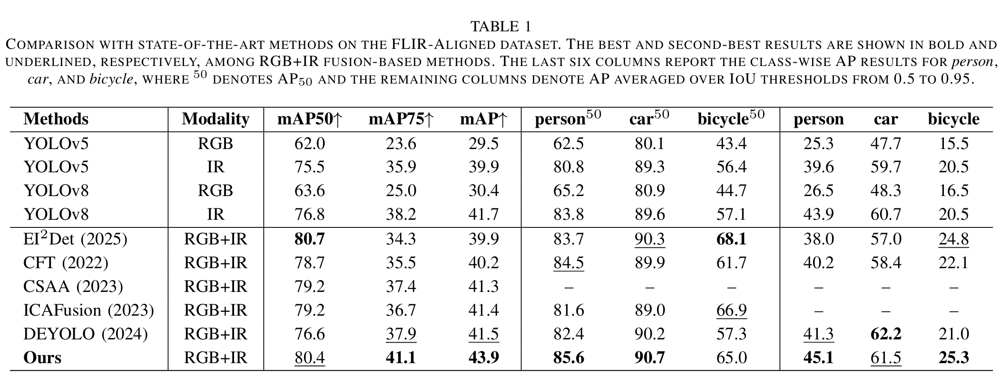
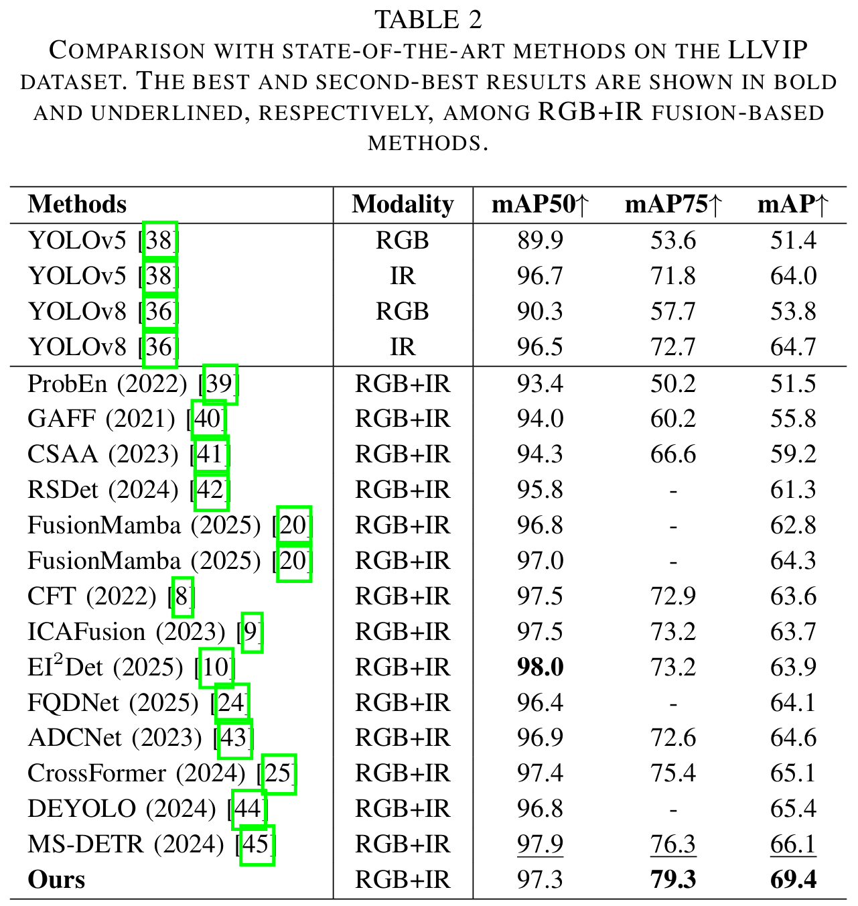
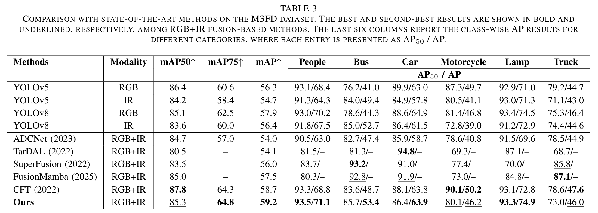

# FAE-Det: Official Implementation

[](https://ieeexplore.ieee.org/document/11653382/)
[](https://github.com/LJs-Projects/FAE-Det/blob/main/LICENSE)
[](https://www.python.org/downloads/)

> **Official PyTorch implementation of "FAE-Det: Frequency-Aware Enhancement Network for Infrared-Visible Object Detection" published in IEEE Transactions on Circuits and Systems for Video Technology, 2026.**
This repository contains the complete codebase for our paper. It builds upon the state-of-the-art YOLO framework.

## 🏗️ Framework


## 📋 Table of Contents

- [Environment Setup & Installation](#-environment-setup--installation)
- [Dataset](#-dataset)
- [Quick Start](#-quick-start-usage)
- [Acknowledgements](#-acknowledgements)
- [Citation](#-citation)
- [License](#-license)

---

## 🛠️ Environment Setup & Installation

To ensure full reproducibility, we recommend using **Anaconda** to manage the Python environment.

### Prerequisites

- **Operating System:** Linux (Ubuntu 20.04 or later)
- **Hardware:** NVIDIA GPU with at least [24GB] VRAM recommended for training. 
- **CUDA:** Version 11.8 .

### Step-by-Step Installation

**Step 1: Create the environment**

Create and activate a Conda environment with Python 3.10:

```bash
conda create -n FAE-Det python=3.10 -y
conda activate FAE-Det
```

**Step 2: Install PyTorch**

Install PyTorch with CUDA support:

```bash
conda install pytorch torchvision torchaudio pytorch-cuda=11.8 -c pytorch -c nvidia
```
For a different PyTorch/CUDA version, please refer to the [official PyTorch installation guide](https://pytorch.org/get-started/locally/).

**Step 3: Install Mamba**

Please refer to the installation instructions in the [HZAI-ZJNU/Mamba-YOLO](https://github.com/HZAI-ZJNU/Mamba-YOLO) repository.

**Step 4: Install other dependencies**

Please refer to the installation instructions in the official [ultralytics/ultralytics](https://github.com/ultralytics/ultralytics) repository.

---

## 📦 Dataset

We evaluate our method on three public RGB-thermal object detection datasets: **FLIR-Aligned**, **LLVIP**, and **M3FD**. All annotations follow the **YOLO** label format.

#### Offcial
| Dataset | Download | Note |
|:--------|:---------|:-----|
| **FLIR-Aligned** | [Google Drive](https://drive.google.com/file/d/1xHDMGl6HJZwtarNWkEV3T4O9X4ZQYz2Y/view) \| [Hugging Face](https://huggingface.co/datasets/bushwang/FLIR_aligned) | Aligned version by Zhang et al. |
| **LLVIP** | [Official Homepage](https://bupt-ai-cz.github.io/LLVIP/) | Visible-infrared paired dataset for low-light vision |
| **M3FD** | [Google Drive](https://drive.google.com/drive/folders/1H-oO7bgRuVFYDcMGvxstT1nmy0WF_Y_6) | Publicly available from the TarDAL repository |

#### Baidu Netdisk (Ours)

| Dataset | Download | Code |
|:--------|:---------|:-----|
| **FLIR-Aligned** | [Baidu Netdisk](https://pan.baidu.com/s/1x7zlXjpqZ8UOeEHOYVm3eg?pwd=6wy2) | 6wy2 |
| **LLVIP** | [Baidu Netdisk](https://pan.baidu.com/s/1PoybIOX33zju6tTWuaQvxg?pwd=q7fy ) | q7fy |
| **M3FD** | [Baidu Netdisk]( https://pan.baidu.com/s/1G8b6UK0SG9MqJRUnAsjZCg?pwd=itbi ) | itbi |

### Dataset Structure

The dataset should be organized under the `datasets/` directory as follows:

```
datasets/
├── image/    # Infrared (IR) images
│   ├── train/
│   ├── test/
├── images/   # Visible (RGB) images
│   ├── train/
│   ├── test/
└── labels/   # Shared labels
    ├── train/
    ├── test/
```

### Dataset Configuration

Create a `data.yaml` file for each dataset.
The following example is based on the **FLIR-Aligned** dataset :


```yaml
train: /path/to/dataset/images/train/
val: /path/to/dataset/images/test/
test: /path/to/dataset/images/test/

train_ir: /path/to/dataset/image/train/
val_ir: /path/to/dataset/image/test/
test_ir: /path/to/dataset/image/test/

# number of classes
nc: 3

# class names
names: ['person', 'car', 'bicycle']
```

---

## 🚀 Quick Start

Before running, please **set the parameters in the script** (e.g., model, dataset, batch size, epochs, device) according to your own setup.

### Train

```bash
python train.py 
```

### Test

```bash
python test.py 
```

### Detect

```bash
python detect.py 
```

---

## 📊 Results

### Qualitative Results

<p align="center">
  
</p>

<p align="center">
  
</p>

<p align="center">
  
</p>

The best results of our method on three RGB-thermal datasets are reported below:

| Method | Dataset | mAP@0.5 | mAP@0.75 | mAP@0.5:0.95 | Download Link |
|:-------|:--------|:-------:|:--------:|:------------:|:--------------|
| Baseline | FLIR-Aligned | 76.2 | 38.3  | 41.7  | https://pan.baidu.com/s/1zEjdKIrS_4nhJAZisJ5btw?pwd=ngjf 提取码: ngjf |
| Baseline | LLVIP | 96.5 | 75.4  | 65.6  | https://pan.baidu.com/s/1oX0-LgQIN-Wzehcum7tRxA?pwd=bxn2 提取码: bxn2 |
| **FAE-Det (Ours)** | FLIR-Aligned | 80.4 | 41.1 | 43.9 | https://pan.baidu.com/s/1uz4301KnHB7uC86Pj_CMxw?pwd=9fii 提取码: 9fii |
| **FAE-Det (Ours)** | LLVIP | 97.3 | 79.3 | 69.4 | https://pan.baidu.com/s/16XDydV-9oG61cNqku3Speg?pwd=4yq1 提取码: 4yq1 |
| **FAE-Det (Ours)** | M3FD | 85.3 | 64.8 | 59.2 | https://pan.baidu.com/s/1QYLGN9kQq52JopFPa4jnPA?pwd=rhr8 提取码: rhr8 |

All experimental results reported in the paper (Table 1 – Table 12) are available at the link below:

- **Baidu Netdisk:** [Download all weights](https://pan.baidu.com/s/1qX8HSPPCnVvMZNVhVYUr1w?pwd=kezk 提取码: kezk)

---

## 🙏 Acknowledgements

We sincerely thank the following open-source projects, without which this work would not have been possible:

- [Ultralytics YOLO](https://github.com/ultralytics/ultralytics): We thank the authors for releasing the Ultralytics YOLO codebase.
- [HZAI-ZJNU/Mamba-YOLO](https://github.com/HZAI-ZJNU/Mamba-YOLO): We thank the authors for releasing the Mamba-YOLO codebase.
- [Linwei-Chen/FreqFusion](https://github.com/Linwei-Chen/FreqFusion): We thank the authors for releasing the FreqFusion codebase for frequency-aware feature fusion.
---

## 📖 Citation

If you find our work useful for your research, please consider citing our paper:

```bibtex
@ARTICLE{11653382,
  author={Li, Jie and Sui, Chenhong and Meng, Yu and Zhang, Bing and Vivone, Gemine and Zhou, Jun},
  journal={IEEE Transactions on Circuits and Systems for Video Technology}, 
  title={FAE-Det: Frequency-Aware Enhancement Network for Infrared-Visible Object Detection}, 
  year={2026},
  volume={},
  number={},
  pages={1-1},
  keywords={Frequency;Modeling;Modules (abstract algebra);High frequency;Object detection;Signal detection;Technology;Finite impulse response filters;Computers;Conferences;Infrared-Visible object detection;multimodal;fusion},
  doi={10.1109/TCSVT.2026.3723123}}

```

---

## 📜 License

This project is released under the [AGPL-3.0 License](LICENSE) for compatibility with YOLO. Please check the license terms before using this code for commercial purposes.

---

**Star ⭐ this repository if you find it useful!**
